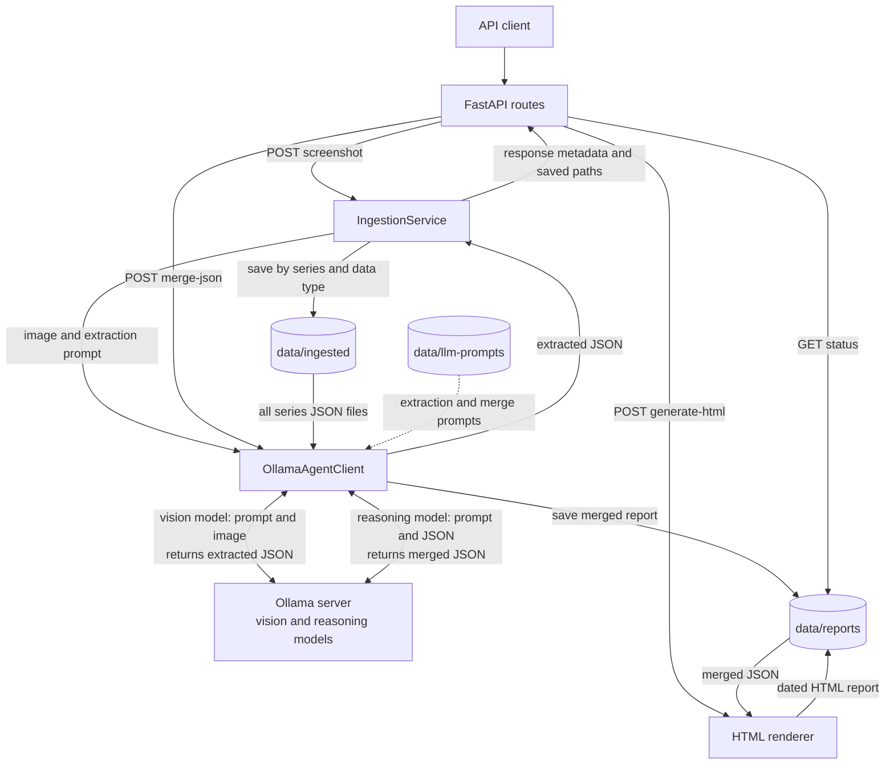

# Architecture

## Overview

The service is a Python 3.14 FastAPI application. It uses Ollama through one configured `OLLAMA_BASE_URL`, with separate models for screenshot extraction and report merging:

- `OLLAMA_VISION_MODEL` (`qwen2.5vl:7b` by default) reads screenshots.
- `OLLAMA_REASONING_MODEL` (`gemma4:12b` by default) merges source JSON into a report.

Prompts are read from `data/llm-prompts/`. Ingested JSON and generated reports are stored under `data/` in the repository working directory.

## Component and data flow

## Screenshot ingestion

`POST /ingest/{series_type}/{data_type}/` accepts an image in the multipart `image` field. The path selects the series and extraction type; supported data types are `odds`, `scores`, and `schedules`. The route normalizes the series value to a canonical uppercase code, validates the image, and calls `IngestionService`.

The service selects the matching prompt, sends the image and prompt to the vision model through `OllamaAgentClient`, parses the model response as a JSON object, and saves the extraction under `data/ingested/{series_type}/{data_type}/`. The `{series_type}` path component here is the normalized code, such as `WCS`. The filename includes the UTC ingestion timestamp and request ID. Uploaded image bytes are sent to Ollama and are not saved by the service.

The response includes request metadata, extracted data, warnings, confidence, and the saved file path. Score payloads are normalized to the documented fields before saving; odds and schedule outputs follow their prompts.

## Report generation

Report generation has three endpoints, all keyed by `series_type`:

1. `POST /reports/{series_type}/merge-json` reads every JSON file from `data/ingested/{series_type}/*/`, groups files by input type, and sends them with `mlb-data-merge.txt` to the reasoning model. The returned JSON is saved as `data/reports/{series_type}/report-merged.json` without schema validation.
2. `POST /reports/{series_type}/generate-html` reads the merged JSON and passes it to the HTML renderer. The renderer output is saved as `data/reports/{series_type}/report-YYYY-MM-DD.html`, using the server-local generation date.
3. `GET /reports/{series_type}/status` reports whether the merged JSON and latest generated HTML exist, with their paths and modification times.

The merge endpoint removes existing `.json` files from the series report directory immediately before saving the new merged report. Keep unrelated JSON artifacts out of that directory.

## Configuration and boundaries

`OLLAMA_BASE_URL` is shared by both model roles. `AGENT_TIMEOUT_SECONDS` applies to Ollama inference requests. The extraction and merge prompt files are application inputs and must be present in deployments; `data/ingested/` and `data/reports/` hold runtime artifacts and should be persisted separately when needed.

The health endpoint only confirms that the FastAPI process is responding. It does not check Ollama availability or report storage. Screenshot extractions are parsed as JSON objects but are not generally validated against the extraction models before being saved; score fields are normalized by the ingestion service.
